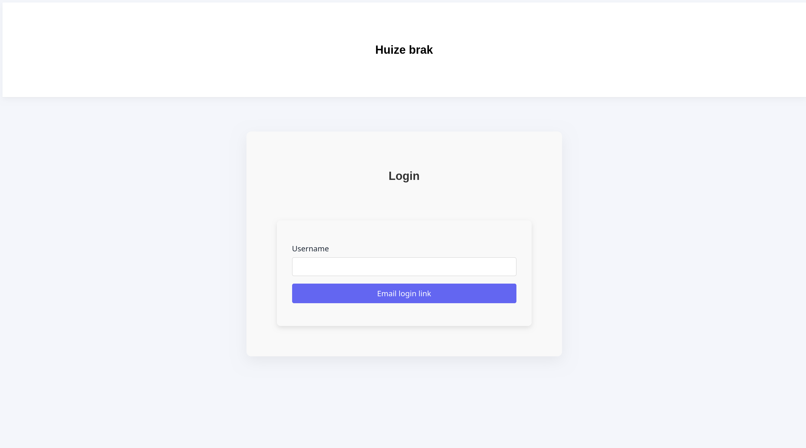
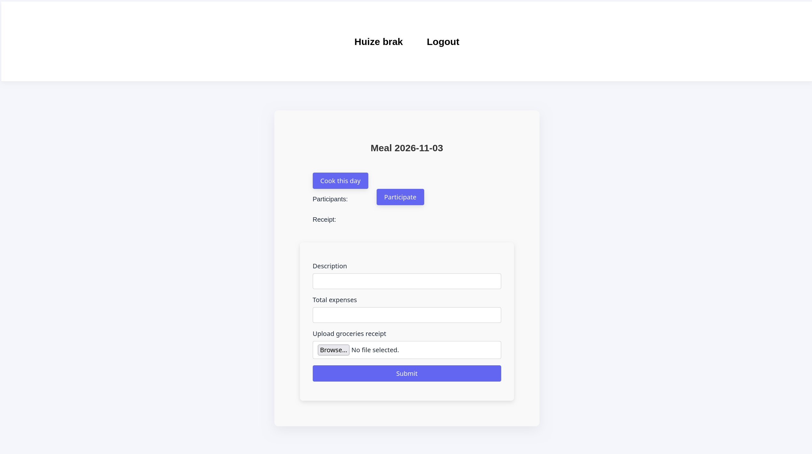
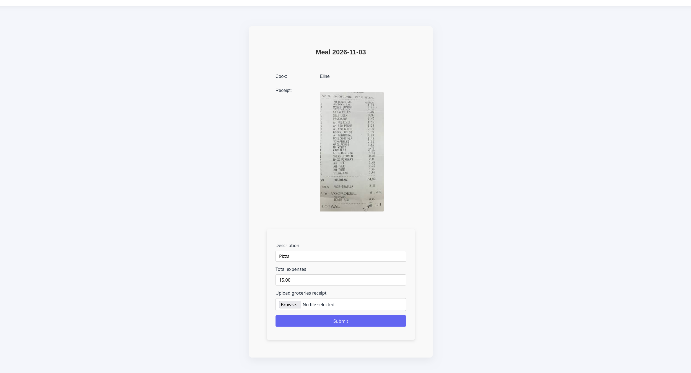
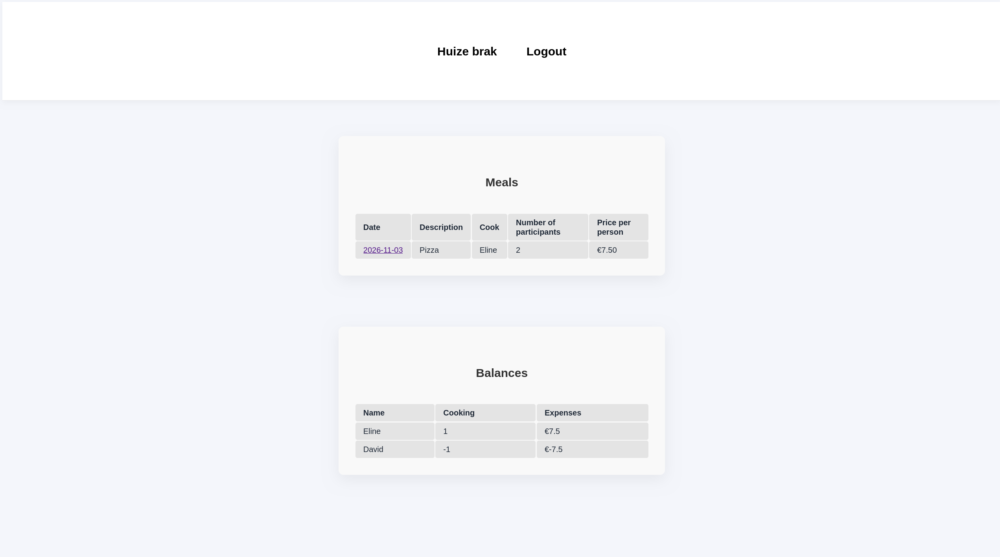

# Student Meal app

An application for student houses that helps students organise shared meals and keep track of shared expenses.
This project is developed as a school project, focussed on building secure webapps using Flask, SQL and Python.
Students can browse meals by date, sign-up to cook, join available meals and view an expenses balance.

## Screenshots

<details>
<summary> Desktop Screenshots</summary>

### Home & Trips Overview


### Sign up to cook


### Meal info


### Meals & expenses

</details>


## Features

#### User Management

User registration and login.
User authentication and session management.
Personal accounts for students.

#### Meal Management

Browse available meals by date.
Sign up to cook for a meal.
View individual meal pages.
See which students have signed up.
Close registrations when a receipt has been uploaded.

#### Expense Management

Track the costs of shared meals.
Calculate the total expenses.
Keep track of the balance between participants.
Calculate who owes what.

#### Email Functionality
Email functionality implemented using Ethereal Email for development and testing purposes.

## Built With

Flask
SQL
Python
HTML5
CSS3

## Project Structure

The application is organised into 13 Vue components, multiple composables and views.

This structure helps separate responsibilities and keeps the application organised and maintainable.

## What I Learned

Flask: Building a dynamic web application using routes, views and templates.
SQL & Databases: Storing and managing application data.
Object-Relational Mapping (ORM): Working with database records through Python objects instead of writing raw SQL queries for every operation.
Form Handling: Processing and validating user input from registration, login and meal forms.
Authentication: Managing user accounts and login sessions.
Ethereal mail: Implementing user registration and authentication, using Ethereal mail.
Web Application Security: Applying security principles when handling user input, authentication and application data.
Back-end logic: Implementing backend logic for shared expense calculations.

## Getting Started

#### Prerequisites
- Python (compatible with the project's Python version).
- pip (Python package installer).
- A code editor or IDE, such as Visual Studio Code.
- Git.

#### Installation

1. Clone the repository:
```bash
git clone https://github.com/Eline304/Student-house-meal-app.git
```
2. Navigate to the project directory:
```bash
cd cooking-app
```
3. Create a virtual environment
```bash
python -m venv venv
```
4. Activate the virtual environment
Windows
```bash
venv\Scripts\activate
```
Max/Linux
```bash
source venv/bin/activate
```
5. Install the dependencies
```bash
pip install -r requirements.txt
```
6. Start the flask application
```bash
flask --app app run
```
Navigate to the application in your browser: http://127.0.0.1:5000

7. Use Ethereal mail
```bash
Email Testing with Ethereal

This application uses Ethereal Email as a test SMTP service for sending login links.

The SMTP configuration is defined in the application's send_email() function.

To view emails sent by the application:

Visit Ethereal Email.
Log in using the Ethereal test credentials configured in the application.
Open the inbox to view captured emails.

Emails sent through Ethereal are not delivered to real recipients.
```


## Development

Independently developed as a school assignment focused on creating secure web applications.
